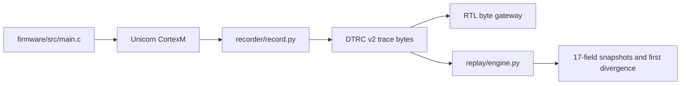

# Deterministic Cortex-M Trace and Replay

An `rr`-style record/replay debugger for Cortex-M firmware: capture IRQ, MMIO, and DMA nondeterminism into a CRC-validated DTRC v2 stream, replay a genuine ELF with bit-identical 17-field register snapshots, and carry a Verilator-validated FPGA capture gateway for eventual physical ingress.

Phase-0 evidence runs entirely on the host. This repository does **not** claim physical-board capture, ETM correctness, sustained bandwidth, or hardware timing.

[](https://github.com/RahilBhavan/cortex-m-deterministic-replay/actions/workflows/ci.yml)

## Start here



| Need | Canonical page | Owner |
|---|---|---|
| Architecture and data flow | [docs/architecture.md](docs/architecture.md) | architecture |
| Wire bytes and tags | [docs/trace-format.md](docs/trace-format.md) | trace-format |
| Record/replay algorithms | [docs/emulator-record-replay.md](docs/emulator-record-replay.md) | emulator-record-replay |
| Firmware race | [docs/firmware-race.md](docs/firmware-race.md) | firmware-race |
| RTL and CDC | [docs/rtl-gateway.md](docs/rtl-gateway.md) | rtl-gateway |
| Numeric evidence | [docs/verification.md](docs/verification.md) | verification |
| Operations | [docs/runbooks.md](docs/runbooks.md) | runbooks |
| Interview demo script | [docs/demo-script.md](docs/demo-script.md) | demo-script |
| Resume bullets | [docs/resume-bullets.md](docs/resume-bullets.md) | resume-bullets |
| Physical handoff | [docs/hardware-handoff.md](docs/hardware-handoff.md) | hardware-handoff |

## Reproduce

Prerequisites: Python 3.10+, ARM GCC (`arm-none-eabi-gcc`), and (for the full gate) Verilator. `.venv/` is gitignored and must be created locally.

```sh
python3 -m venv .venv
.venv/bin/pip install -r requirements.txt
make demo
```

`make demo` locks seed-0 race corruptions at 2/1000 and replays one corrupting schedule bit-identically (~10–15s). Full host+RTL gate and campaign evidence:

```sh
make check
make evidence
make synth
PATH=/tmp/nextpnr-build:$PATH make pnr
git diff --check
```

The firmware target is `firmware/build/race.elf`; host tests use `python -m unittest discover -v`; gateway tests are Verilator simulations. macOS installation and nextpnr build instructions are in [docs/macos-setup.md](docs/macos-setup.md). Contribution notes are in [CONTRIBUTING.md](CONTRIBUTING.md).

## Evidence snapshot

| Measurement | Observed result | Interpretation |
|---|---:|---|
| Race campaign | seeds 0–3: 2/1/2/1 corruptions per 1,000 | deterministic host campaign |
| Codec | 10,000 randomized round trips | DTRC encode/decode coverage |
| Real replay | 100,000/100,000 | 17 fields per snapshot |
| Divergence/replay | 20/20 clean and corrupt schedule 4 | real MMIO/differ diagnostics |
| Demo trace | 66 bytes, 7 events, 9.43 bytes/event | encoded stream size only |
| P&R | 97 LUT4, 91 DFF, 217.58 MHz provisional, 54 warnings | unassigned-I/O provisional result |

No bytes/sec number is reported: there is no defensible emulated-duration or clock contract. QEMU 11.0.3 boots the genuine image on `mps2-an385`, but does not expose the exact retirement/register/MMIO/IRQ controls required by this experiment. Unicorn 2.1.4 is therefore the real instruction core with a narrow exception shim, not a board model.

## Limitations and handoff

Physical work remains: board/device/pin selection, ETM or trace ingress, CDC/reset validation, DDR buffering, legal constraints, on-device capture, and replay acceptance. See [docs/hardware-handoff.md](docs/hardware-handoff.md), [docs/ROADMAP.md](docs/ROADMAP.md), and [docs/hardware-boundary.md](docs/hardware-boundary.md).

## Glossary

**DTRC**: Deterministic Trace Record Container. **Retirement**: one completed instruction step in the host model. **MMIO**: memory-mapped I/O. **CDC**: clock-domain crossing. **ETM**: Embedded Trace Macrocell. **P&R**: place and route. **Fmax**: provisional timing estimate, not board timing.
