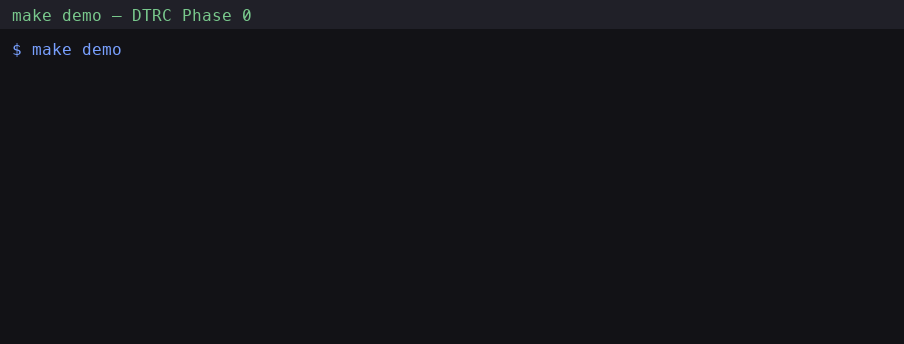
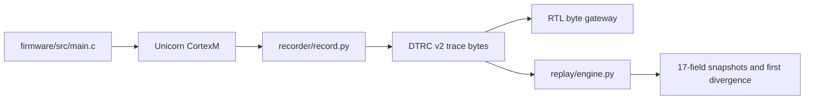

# Deterministic Cortex-M trace and replay: bit-identical record and replay of firmware races on a host instruction core

[](https://github.com/RahilBhavan/cortex-m-deterministic-replay/actions/workflows/ci.yml) [](LICENSE)



This is a Phase-0 prototype of an `rr`-style record and replay debugger for Cortex-M firmware. A Unicorn 2.1.4 instruction core runs a bare-metal Cortex-M3 race ELF. The recorder writes every IRQ, MMIO read, and DMA write into DTRC v2, a CRC32-checked varint trace format. Replay reproduces 17-field register snapshots bit-identically, and a SystemVerilog capture gateway carries the same trace bytes in Icarus and Verilator simulation. Everything runs on the host. There is no physical board capture yet.

## What it does

Each number below comes from the named test or doc. CI run [31524893189](https://github.com/RahilBhavan/cortex-m-deterministic-replay/actions/runs/31524893189) on 2026-08-11 passed all 39 unit tests against the built ELF.

| Capability | Observed result | Source |
|---|---|---|
| Firmware race | 2, 1, 2, and 1 corruptions per 1,000 trials for seeds 0–3 | `tests/test_firmware_race.py` (seed 0), [docs/verification.md](docs/verification.md) (seeds 1–3) |
| Real-ELF replay | 100,000 of 100,000 instruction snapshots identical. Each snapshot has 17 fields: R0–R12, SP, LR, PC, and xPSR. | `tests/test_replay.py` |
| Race replay | One corrupting schedule (IRQ at instruction 4, seed 0) recorded and replayed 20 times, 20 of 20 identical | `tests/test_race_replay.py` |
| Trace codec | 10,000 seeded random encode and decode round trips, plus malformed-input rejection | `tests/test_trace.py` |
| First divergence | An altered MMIO read override reports the first mismatched snapshot, with disassembly | `tests/test_differ.py`, `tools/differ.py` |
| Golden stream | 66 bytes, 7 events (9.43 bytes per event), carried byte-for-byte through the RTL FIFO in Icarus and the capture gate in Verilator | `examples/golden-demo.dtrc`, `tests/test_end_to_end.py` |
| ECP5 synthesis | 41 LUT4, 93 FF, 2 EBR, 22 CCU2C (Yosys) | [docs/rtl-results.md](docs/rtl-results.md) |
| Place and route | 111 TRELLIS_COMB, 93 TRELLIS_FF, 211.42 MHz estimate, 54 warnings for unassigned I/O. This is provisional, not board timing. | [docs/rtl-results.md](docs/rtl-results.md) |

The project reports no bytes-per-second figure. Instruction count is not an emulated clock, so the 66-byte stream has no duration to divide by.

## How it works



- `firmware/src/main.c` holds a two-word invariant. `Timer_Handler` updates the words in two stores, and the main loop reads them in two loads, so an IRQ between the loads corrupts the pair.
- `recorder/emulator.py` wraps Unicorn. It counts retired instructions, decodes Thumb-16 branches, and injects an IRQ at an exact instruction count through a narrow exception shim. The shim is not an NVIC model.
- `recorder/record.py` records IRQ (tag 1), MMIO read (tag 2), and DMA (tag 3) events. `trace/format.py` encodes them as DTRC v2 with a build ID and CRC32.
- `replay/engine.py` re-runs the same ELF, applies the events at their recorded instruction counts, and compares snapshots. `tools/differ.py` reports the first divergence.
- `gateway/rtl/` holds the capture path: a synchronous FIFO, DDR capture, an async FIFO for the clock-domain crossing (CDC), and reset synchronizers. The gateway transports bytes only and does not parse DTRC.

QEMU 11.0.3 boots the same image on `mps2-an385`, but its interfaces do not expose exact instruction retirement, full register snapshots, MMIO read override, or count-indexed IRQ injection. [docs/qemu-instrumentation.md](docs/qemu-instrumentation.md) records that dead end.

## Run it

Prerequisites:

- Python 3.10 or later (CI uses 3.12) and `unicorn==2.1.4` from `requirements.txt`.
- The Arm GNU Toolchain (`arm-none-eabi-gcc`) to build `firmware/build/race.elf`. CI pins 15.2.Rel1 with a SHA-256 check.
- Icarus Verilog for the golden-stream FIFO test. Verilator for `make check` and the RTL targets.
- Yosys, Project Trellis, and nextpnr-ecp5 only for `make synth` and `make pnr`. [docs/macos-setup.md](docs/macos-setup.md) lists the observed versions.

Install the Python dependencies, then run the race demo. `make demo` builds the firmware, checks that seed 0 gives 2 corruptions, and replays one corrupting schedule.

```sh
make setup   # creates .venv and installs the hashed, pinned requirements.txt
make demo
```

Run the unit tests:

```sh
.venv/bin/python -m unittest discover -v
```

The suite has 39 tests. With the ELF built and Icarus installed, all 39 pass (CI, 2026-08-11; locally on 2026-10-24, see below). Without the ELF, 16 tests skip with the message "run `make firmware`" and 23 pass (observed 2026-10-24). With the pinned 15.2.Rel1 toolchain but no Icarus, 37 pass and 2 skip (observed 2026-10-24, Linux x86_64, Python 3.14.7). The DTRC codec tests need neither.

Run the full host and RTL gate, the seed campaign, and the FPGA flow:

```sh
make check      # unit tests, model demo, Verilator FIFO and capture-gate tests
make evidence   # race campaign for seeds 0-3, then the model demo
make synth
PATH=/tmp/nextpnr-build:$PATH make pnr
```

CI has two jobs. `host-tests` installs the hashed requirements, runs `ruff check`, builds the firmware, runs the 39 tests, carries the golden trace through the Icarus FIFO, and runs `make demo`. `rtl-verilator` runs the Verilator and Yosys checks with `continue-on-error`, because Ubuntu Verilator packages vary.

## Repository layout

- `firmware/`: bare-metal Cortex-M3 race firmware and MPS2 linker script.
- `recorder/`: Unicorn wrapper, event recorder, and race campaign (`race_rate.py`).
- `replay/`: real-ELF replay engine and a model-only seven-tag demo.
- `trace/`: DTRC v2 encoder and decoder.
- `tools/`: race demo, snapshot differ, trace statistics, and demo-asset recorder.
- `gateway/`: SystemVerilog RTL, simulation benches, and provisional ECP5 constraints.
- `tests/`: unit, replay, codec, and end-to-end RTL tests.
- `examples/`: the 66-byte golden DTRC stream and its hex dump.
- `docs/`: design, evidence, ceilings, and hardware handoff pages.
- `AGENTS.md`, `.claude/`: agent workflow files that Rahil's coding agents read. They are not part of the DTRC design.

## Documentation

[docs/index.md](docs/index.md) maps every page. The main ones:

- [Architecture](docs/architecture.md): components, data flow, and boundary ownership.
- [DTRC v2 wire format](docs/trace-format.md): tags 1–7, varints, CRC32, and validation rules.
- [Emulator, recording, and replay](docs/emulator-record-replay.md): the Unicorn choice, the IRQ shim, and the replay algorithm.
- [Firmware race](docs/firmware-race.md): the invariant, insertion points, and seeds.
- [RTL gateway](docs/rtl-gateway.md) and [RTL results](docs/rtl-results.md): capture paths, CDC, reset, and synthesis output.
- [Verification](docs/verification.md): every measured number with its command.
- [Ceilings](docs/ceilings.md): what the evidence does not show.
- [Runbooks](docs/runbooks.md): repeatable commands and troubleshooting.
- [Hardware handoff](docs/hardware-handoff.md) and [roadmap](docs/ROADMAP.md): the physical work that remains.
- [Demo script](docs/demo-script.md) and [writeup](docs/writeup.md): presentation material that quotes only the verified numbers.
- [Cortex-M replay textbook](.claude/artifacts/cortex-m-replay-textbook.html): a long beginner walkthrough, from the first run to the CDC benches.

## Scope and limits

- Independent portfolio work. Not affiliated with Arm, the Unicorn project, Lattice, or any employer.
- Phase-0 prototype. Everything runs on the host. There is no physical-board capture and no Embedded Trace Macrocell (ETM) ingress.
- Unicorn is an instruction core with a narrow IRQ shim. It has no hardware stacking, priorities, masking, nested IRQs, or general NVIC model.
- The emulator decodes Thumb-16 `B` and `B<cond>` branches, which is all the race ELF needs. Full Thumb-32 control flow, such as every `BL` and `BLX` form, is not covered.
- Real replay supports tags 1–3 only. Tags 4–7 exist in the model demo and are rejected for real ELFs.
- Place and route is provisional. The constraints file sets only a 100 MHz clock and assigns no pins, so 211.42 MHz is a tool estimate.
- No sustained bandwidth or bytes-per-second claim.
- On 2026-10-24 the race seeds 0–3 (2, 1, 2, 1 corruptions), the 100,000-snapshot replay and `make demo` were reproduced locally with the pinned Arm toolchain. The same day, `make check` (39 tests, model demo, Verilator FIFO and capture-gate benches) and `make rtl-lint` passed locally with the OSS CAD Suite build 2026-10-24 (Verilator 5.053, Icarus Verilog 14.0, Yosys 0.70) unpacked without root. The Yosys synthesis counts, the nextpnr results, and the QEMU 11.0.3 observation were not reproduced on that host. They come from CI and the checked-in docs.
- Planned: board and pin selection, physical trace ingress, CDC and reset checks on silicon, an on-device golden stream, and physical replay acceptance. See [docs/hardware-handoff.md](docs/hardware-handoff.md).

## License

[MIT](LICENSE).

Part of [Rahil Bhavan's projects](https://github.com/RahilBhavan).
