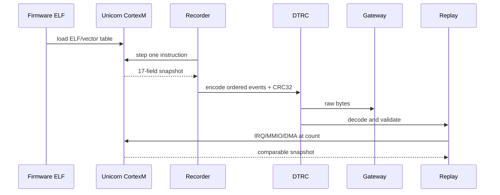

# Architecture and data flow

## Contract

The host produces an ordered DTRC byte stream. The gateway transports bytes and reports `overflow` plus `accepted_count`; it does not decode tags. Replay consumes the same decoded events and applies them before the instruction at the matching count.

| Layer | Implementation | Owns | Does not own |
|---|---|---|---|
| Firmware | `firmware/src/main.c` | race workload/vector table | trace transport |
| Emulator | `recorder/emulator.py` | real instruction core and shim | board model |
| Recorder | `recorder/record.py` | snapshots/events/build ID | wire parsing |
| Wire | `trace/format.py` | DTRC bytes, bounds, CRC | RTL framing |
| Replay | `replay/engine.py` | event application and divergence | physical timing |
| RTL | `gateway/rtl/*.sv` | nibble/byte capture and FIFO | event semantics |

## Boundary rules

The real snapshot is 17 fields: R0–R12, SP, LR, PC, and xPSR. `replay/model.py` is a small model with state plus memory and is not evidence for the real 100,000-state result. QEMU is a boot-smoke host; Unicorn is the deterministic instruction core. The capture FIFO is a same-clock byte FIFO; `capture_gate` adds DDR nibble assembly and an asynchronous FIFO path. `gateway_top` ties both clocks together for representative same-clock synthesis only.

## Failure semantics

Malformed DTRC, build-ID mismatch, invalid event order, FIFO overflow, or DMA bounds violations are errors. RTL overflow is sticky until coordinated reset. An overflowed stream cannot be accepted as a complete trace.
