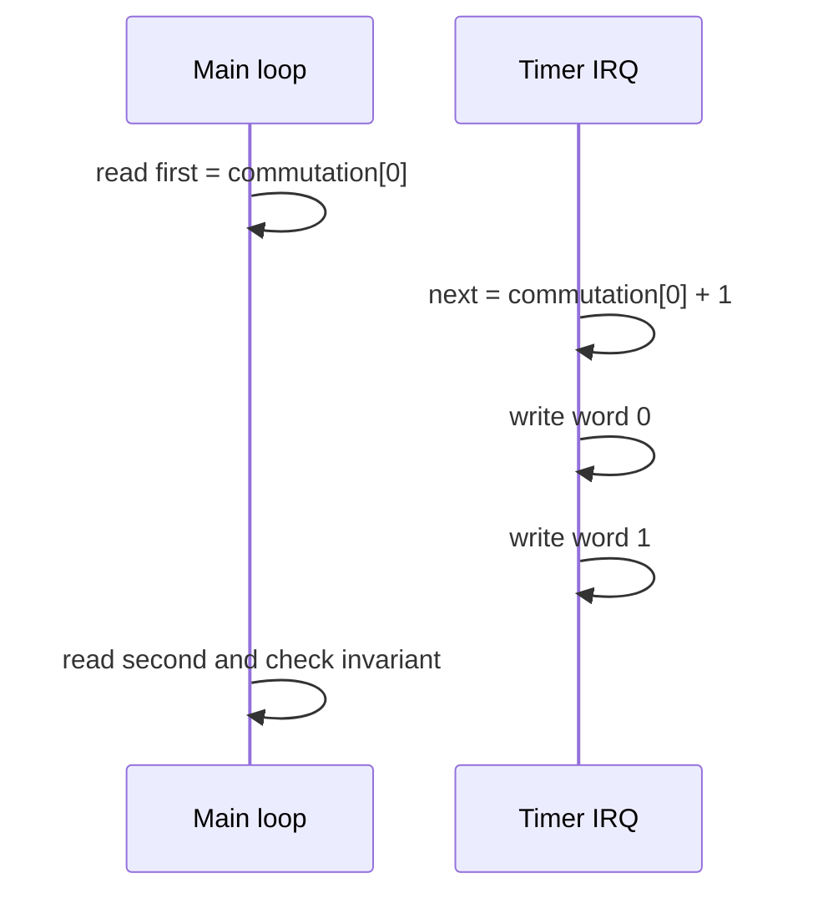

# Firmware race

`firmware/src/main.c` maintains the invariant `commutation[1] == commutation[0] ^ 0x5a5a5a5a`. `Timer_Handler` writes the two words as two separate stores. `Reset_Handler` reads them separately and increments `corruptions` if the pair is inconsistent.

A deterministic insertion schedule chooses one of five instruction positions. The map is based on the current `Reset_Handler` disassembly: counts 0–4 inject before the next PCs shown below. Counts 0–2 leave the semantic state consistent; counts 3–4 interrupt between the first-word store and the second-word store and corrupt the observed pair.

| Insertion count | Next PC | Retired instruction / semantic state |
|---:|---:|---|
| 0 | `0x58` | none; entry before initialization |
| 1 | `0x5a` | `movs r2, #0`; zero prepared for the first store |
| 2 | `0x5c` | `ldr r3, [pc, #32]`; commutation base loaded |
| 3 | `0x5e` | `str r2, [r3, #0]`; first word is zero, second remains old |
| 4 | `0x62` | `mov.w r2, #0x5a5a5a5a`; second-word value prepared, not stored |

The scheduler uses `weights=(998, 1, 1, 1, 1)` over counts 0–4. `recorder/race_rate.py` runs 1,000 seeded trials and reports corruptions, not probability claims beyond that campaign. The exact PCs are compiler/build-dependent; the insertion counts are the scheduling contract. Loop-back branches in the current ELF are followed by Thumb-16 decode (validated against `Reset_Handler` symbols in tests), not hardcoded PC redirects. See [ceilings.md](ceilings.md).

| Seed | Trials | Corruptions |
|---:|---:|---:|
| 0 | 1,000 | 2 |
| 1 | 1,000 | 1 |
| 2 | 1,000 | 2 |
| 3 | 1,000 | 1 |

The replay test selects the first corrupting schedule and repeats it 20 times; recorded and replayed real snapshots match 20/20. This demonstrates deterministic reproduction of the modeled race, not silicon interrupt latency or cache behavior.
