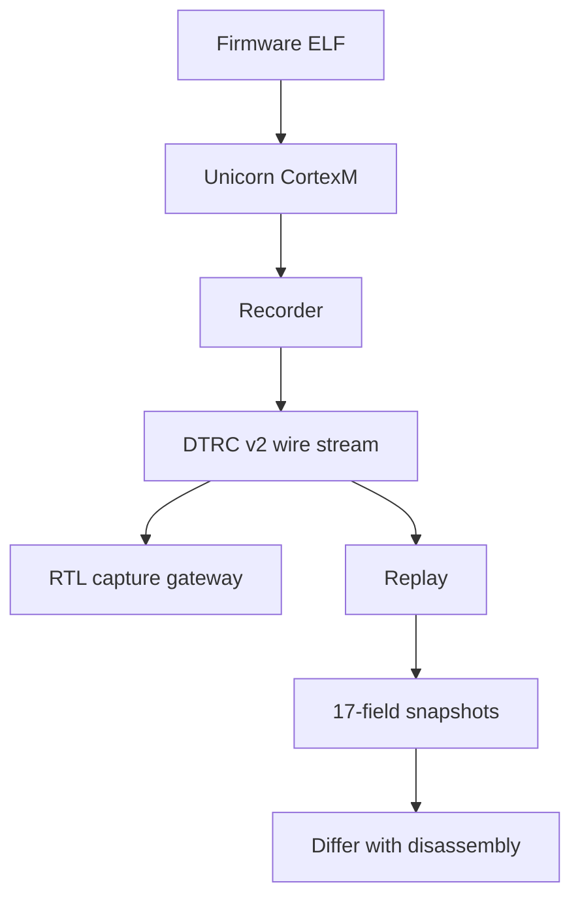

# Documentation index

## Start here

Beginner textbook: [Cortex-M Replay textbook](../.claude/artifacts/cortex-m-replay-textbook.html). Follow this order: mental model and first run, firmware, host model, trace, replay, synchronous FIFO, then DDR/async CDC and benches. The specialist pages below remain canonical; this page is the map, not a duplicate.

## System map

| Page | Scope | Canonical facts |
|---|---|---|
| [architecture](architecture.md) | components and data flow | boundary ownership |
| [emulator-record-replay](emulator-record-replay.md) | algorithms and APIs | QEMU vs Unicorn; 17 fields |
| [trace-format](trace-format.md) | DTRC v2 wire contract | tags 1–7 and validation |
| [firmware-race](firmware-race.md) | commutation race | seeds and schedule |
| [rtl-gateway](rtl-gateway.md) | RTL/CDC design | capture paths and reset |
| [verification](verification.md) | measured numbers | commands and output |
| [runbooks](runbooks.md) | repeatable operations | troubleshooting |
| [demo-script](demo-script.md) | interview talk track | five-minute path |
| [ceilings](ceilings.md) | honesty contract | Unicorn/NVIC, P&R, bytes/sec |
| [writeup](writeup.md) | blog / LinkedIn copy | Phase-0 narrative |
| [hardware-handoff](hardware-handoff.md) | pending physical work | signoff checklist |

Background: [scope](scope.md), [hardware boundary](hardware-boundary.md), [macOS setup](macos-setup.md), [QEMU investigation](qemu-instrumentation.md), [Renode investigation](renode-instrumentation.md), [RTL results](rtl-results.md), [roadmap](ROADMAP.md), [journal](JOURNAL.md), [demo assets](assets/), [emulation-host ADR](adr/001-emulation-host.md), and [gateway-constraints ADR](adr/002-gateway-constraints.md).
