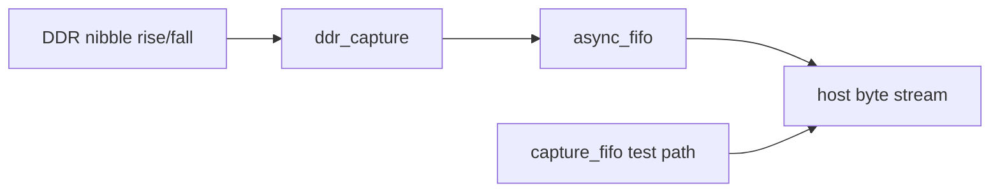

# RTL gateway

## Data path

`ddr_capture.sv` is a logical two-sample packer: it pairs a low/rise sample and high/fall sample into one byte; it is not a physical IDDR primitive. `async_fifo.sv` uses Gray-coded pointers synchronized through marked two-register chains in each clock domain and supports `ADDR_WIDTH >= 1`. `capture_fifo.sv` is the same-clock reference. `capture_gate.sv` combines nibble assembly, asynchronous transport, and sticky overflow. `gateway_top.sv` intentionally connects capture and host clocks to the same `clk` for representative synthesis.

| Signal | Meaning |
|---|---|
| `in_valid/in_ready` or `wvalid/wready` | byte acceptance handshake |
| `host_valid/host_ready` | host-side byte delivery |
| `overflow` | capture-domain sticky loss indication until reset |
| `accepted_count` | capture-domain modulo-`2^32` accepted writes since reset |

Tags 1–3 and 4–7 are not interpreted in RTL; all seven tags remain opaque bytes. `capture_fifo` and the async path are distinct: the former proves same-clock FIFO behavior, the latter is the CDC design pending hardware validation.

## Reset and CDC

`capture_gate.sv` defines `coordinated_reset = capture_reset | host_reset`. Either input asynchronously asserts a two-stage reset synchronizer in both domains; each local reset deasserts synchronously to its own clock. Reset flushes the FIFO, pending half-byte, overflow, and accepted count. After overflow, writes and counter increments remain frozen until reset. The golden-driven independent-clock bench checks normal transport, reset during a half-byte, backpressure overflow, frozen acceptance, and recovery. This is digital RTL evidence, not a physical CDC proof; metastability assumptions, reset-tree behavior, source-clock duty cycle, and silicon validation remain open.

## Provisional result

Synthesis after reset hardening: 41 LUT4, 93 FF, 2 EBR, 22 CCU2C. P&R remains provisional because the device/package/pins and I/O standards are not finalized; numeric ownership is [verification.md](verification.md).
