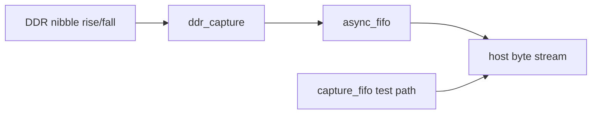

# RTL gateway

## Data path

`ddr_capture.sv` pairs two valid nibbles into one byte. `async_fifo.sv` uses Gray-coded pointers synchronized through two registers in each clock domain. `capture_fifo.sv` is the same-clock wrap/overflow reference tested by the stream bench. `capture_gate.sv` combines DDR assembly, asynchronous transport, and sticky overflow. `gateway_top.sv` intentionally connects capture and host clocks to the same `clk` for a representative synthesis.

| Signal | Meaning |
|---|---|
| `in_valid/in_ready` or `wvalid/wready` | byte acceptance handshake |
| `host_valid/host_ready` | host-side byte delivery |
| `overflow` | sticky loss indication until reset |
| `accepted_count` | bytes accepted into async FIFO write memory |

Tags 1–3 and 4–7 are not interpreted in RTL; all seven tags remain opaque bytes. `capture_fifo` and the async path are distinct: the former proves same-clock FIFO behavior, the latter is the CDC design pending hardware validation.

## Reset and CDC

`capture_gate.sv` defines `coordinated_reset = capture_reset | host_reset`. Either input reset resets both FIFO domains and the DDR assembler, flushing capture and sideband state. Reset release must be coordinated and synchronously observed in each destination clock domain. This is a reset contract, not a physical CDC proof; signoff still requires release sequencing, synchronizer review, metastability assumptions, source-clock duty-cycle checks, and independent-clock overflow tests.

## Provisional result

Synthesis: 41 LUT4, 91 FF, 2 EBR, 22 CCU2C. P&R: 97 LUT4, 91 DFF, 217.58 MHz provisional Fmax at 100 MHz, and 54 unconstrained-I/O warnings. The result is provisional because the device/package/pins and I/O standards are not finalized.
